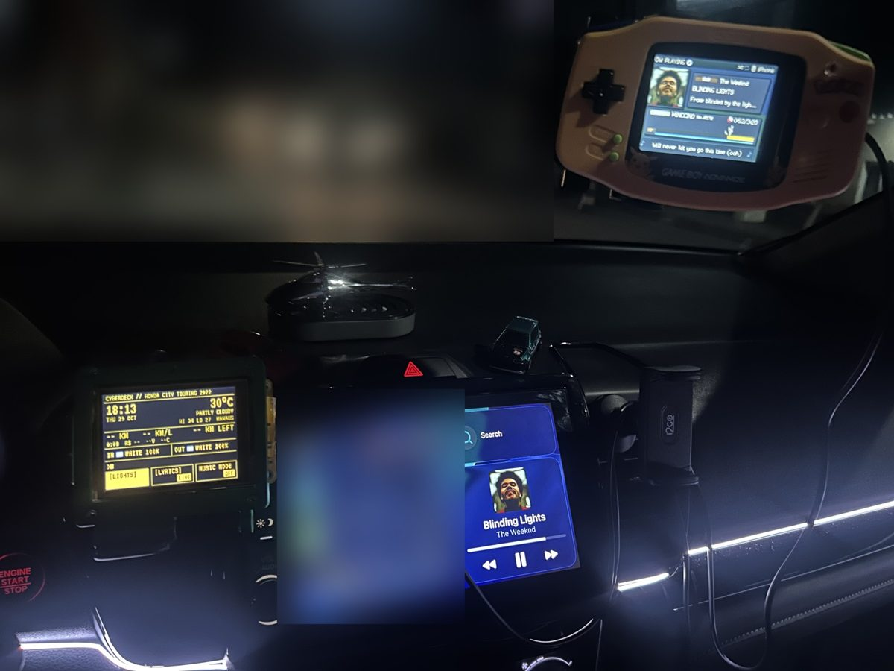
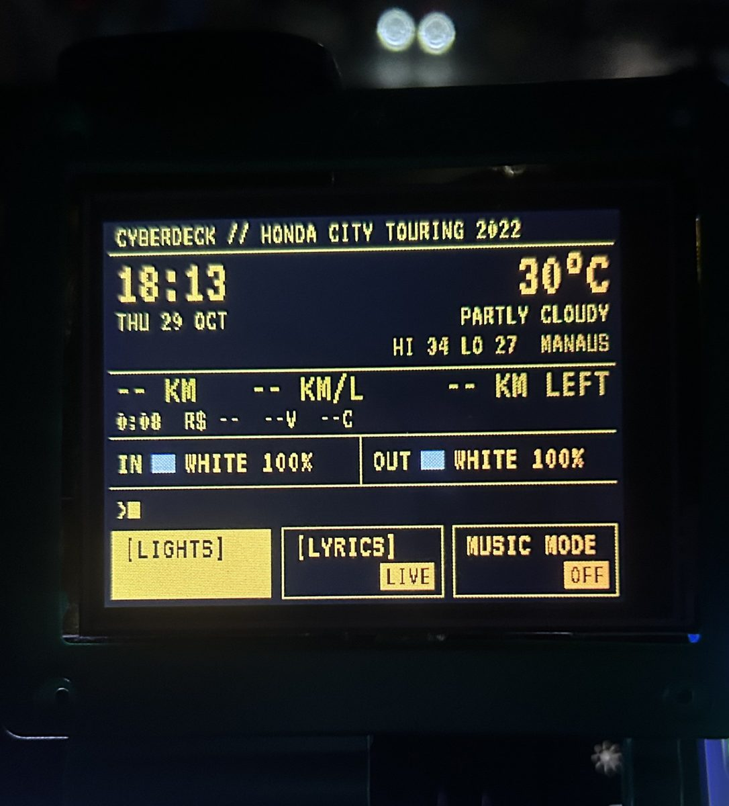

## What it is

A cheap ESP32 touchscreen inside a Game Boy Advance shell on my dashboard. It shows the song playing on Spotify as an old Game Boy-style Pokémon battle. A random Pokémon walks along the HP bar while the song plays, and synced lyrics appear in the dialogue box, including Japanese and Chinese text.

## How it grew

A second screen took over the car's lights. It drives the inside and outside LED controllers over Bluetooth, with a terminal-style dashboard showing the clock, the weather and the trip timer. In music mode the lights follow the colour of each song. Then came more ways to control it: Siri, an Xbox controller and a small app on my Garmin watch. A phone page with a QR code works as a remote, and everything talks over the phone's hotspot, with no server.

## The part I'm careful about

It lives in a moving car on a phone hotspot that drops all the time, so it has to fail safely. Updates go over WiFi, and if a new version crashes early the deck rolls back to the last good one. Watchdogs and back-offs keep it from hanging when a link drops, and the requests that change the lights are signed, so other devices on the hotspot can't take over.

**Stack:** C++17, Arduino, PlatformIO, ESP32 and ESP32-S3, Bluetooth LE, Garmin Connect IQ, host-side unit tests, CI, tagged releases
