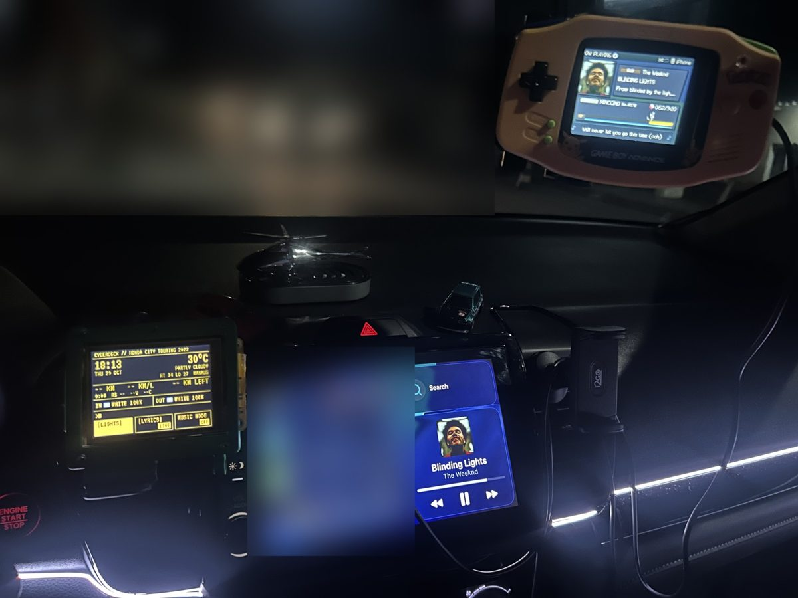
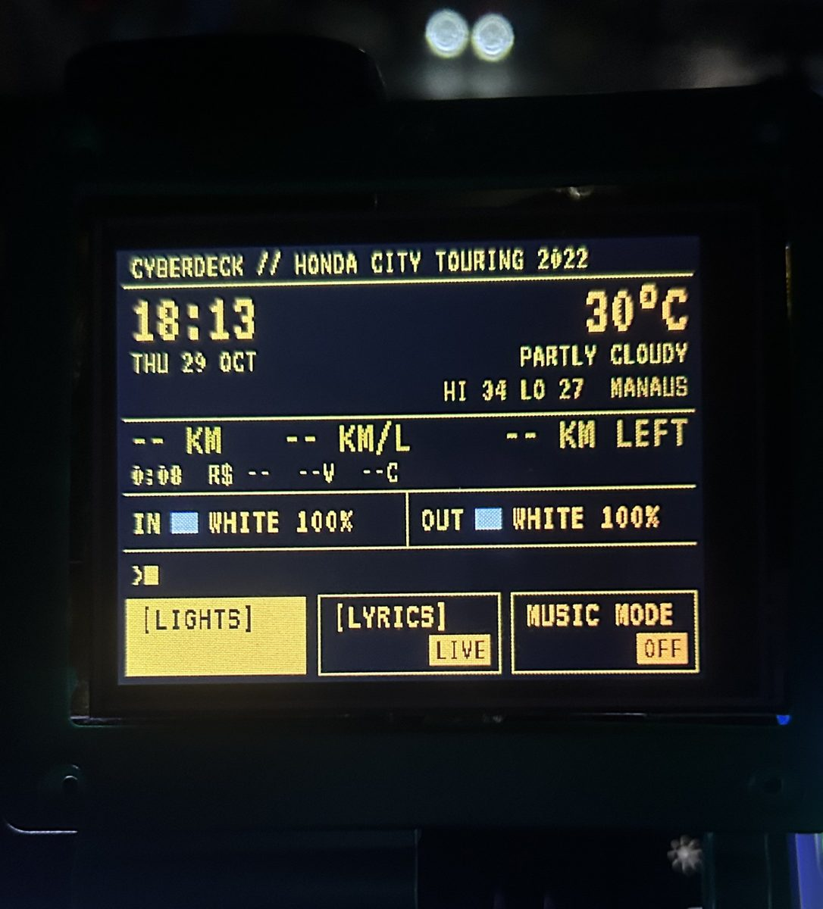

## O que é

Uma tela touch ESP32 baratinha dentro de uma carcaça de Game Boy Advance no painel do carro. Ela mostra a música que tá tocando no Spotify como uma batalha Pokémon das antigas, no estilo Game Boy. Um Pokémon aleatório anda pela barra de HP enquanto a música toca, e a letra sincronizada aparece na caixa de diálogo, inclusive em japonês e chinês.

## Como cresceu

Uma segunda tela assumiu as luzes do carro. Ela comanda os controladores de LED de dentro e de fora por Bluetooth, com um painel estilo terminal mostrando o relógio, o clima e o tempo de viagem. No modo música, as luzes seguem a cor de cada música. Depois vieram mais jeitos de controlar: Siri, um controle de Xbox e um appzinho no meu relógio Garmin. Uma página no celular com QR code funciona como controle remoto, e tudo se comunica pelo hotspot do celular, sem servidor.

## A parte em que eu tomo cuidado

Ele vive num carro em movimento, ligado num hotspot de celular que cai toda hora, então precisa falhar de forma segura. As atualizações chegam por WiFi, e se uma versão nova der crash logo no começo, o deck volta pra última versão boa. Watchdogs e back-offs evitam que ele trave quando uma conexão cai, e os comandos que mudam as luzes são assinados, então outros aparelhos no hotspot não conseguem assumir o controle.

**Stack:** C++17, Arduino, PlatformIO, ESP32 e ESP32-S3, Bluetooth LE, Garmin Connect IQ, testes unitários no host, CI, releases com tag
