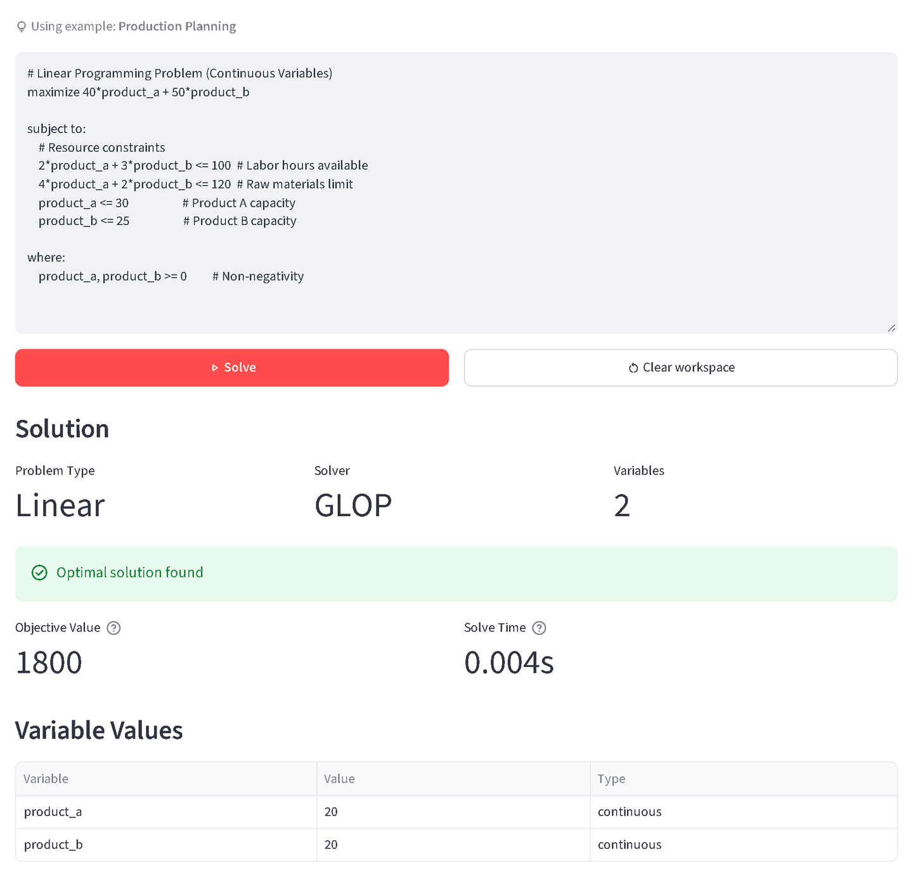

## The problem

Industrial Engineering students at UFAM learn Operations Research mostly on paper. Solvers exist, but they expect code or rigid formats, so students spend their energy on syntax instead of on the model.

## What I built

A Streamlit app where students type a linear or integer programming model in the notation their textbook uses: an objective, the constraints and, if needed, bounds on the variables. A parser I wrote with pyparsing turns that text into a model for Google OR-Tools, which solves it with GLOP for linear problems and SCIP for integer ones. When something is wrong, the error says which line. For problems with two variables the app draws the feasible region from the student's own constraints, with each constraint line, the direction the objective improves and the optimal point. A gallery of examples gets students started, and the whole interface works in English and Portuguese.

The teaching approach comes from Active and Problem-Based Learning: students learn by modeling real problems themselves, not by watching someone else solve them.

## Result

It became my bachelor thesis in Industrial Engineering. When students tried it, 80% rated building a model in the app easy or very easy.

In 2026 I went back to it. I fixed a bug where unbounded problems were reported as infeasible, replaced a plot that only ever showed one example with the real feasible region, and added a test suite of over 170 tests, including headless runs of the whole app. The code and the article's LaTeX source are open source, and the app is live.

**Stack:** Python, Streamlit, Google OR-Tools, pyparsing, Plotly
