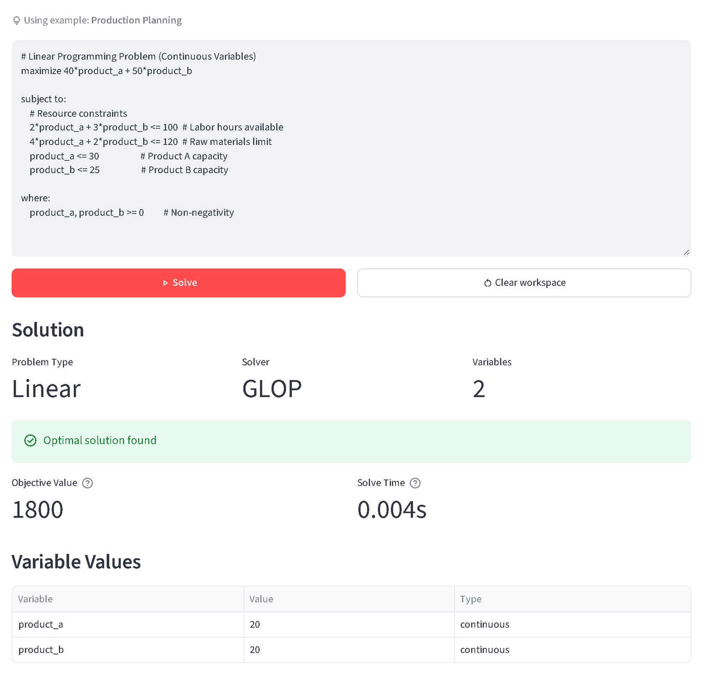

## O problema

Os alunos de Engenharia de Produção da UFAM aprendem Pesquisa Operacional quase sempre no papel. Solvers existem, mas pedem código ou formatos rígidos, então os alunos gastam energia com sintaxe em vez de gastar com o modelo.

## O que eu construí

Um app em Streamlit onde os alunos digitam um modelo de programação linear ou inteira na notação que o livro deles usa: uma função objetivo, as restrições e, se precisar, limites nas variáveis. Um parser que eu escrevi com pyparsing transforma esse texto num modelo pro Google OR-Tools, que resolve com GLOP os problemas lineares e com SCIP os inteiros. Quando algo tá errado, o erro diz em qual linha. Pra problemas com duas variáveis, o app desenha a região viável a partir das restrições do próprio aluno, com cada reta de restrição, a direção em que o objetivo melhora e o ponto ótimo. Uma galeria de exemplos ajuda os alunos a começar, e a interface inteira funciona em inglês e português.

A abordagem de ensino vem da Aprendizagem Ativa e da Aprendizagem Baseada em Problemas: os alunos aprendem modelando problemas reais eles mesmos, e não vendo outra pessoa resolver.

## Resultado

Virou meu TCC em Engenharia de Produção. Quando os alunos testaram, 80% avaliaram montar um modelo no app como fácil ou muito fácil.

Em 2026 eu voltei nele. Corrigi um bug em que problemas ilimitados apareciam como inviáveis, troquei um gráfico que só mostrava um único exemplo pela região viável de verdade e adicionei uma suíte com mais de 170 testes, incluindo execuções headless do app inteiro. O código e o fonte em LaTeX do artigo são open source, e o app tá no ar.

**Stack:** Python, Streamlit, Google OR-Tools, pyparsing, Plotly
